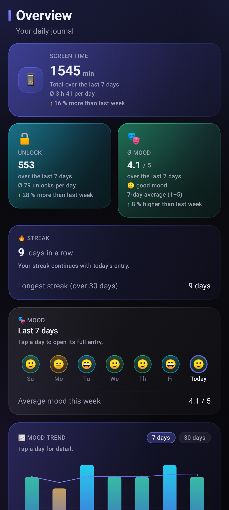
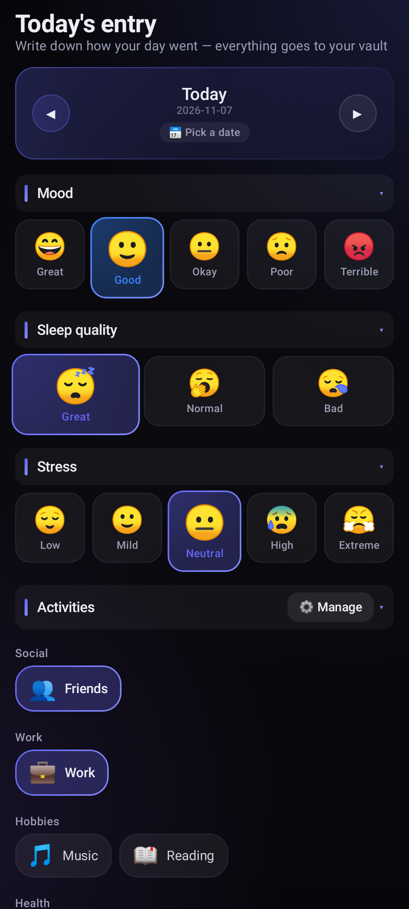
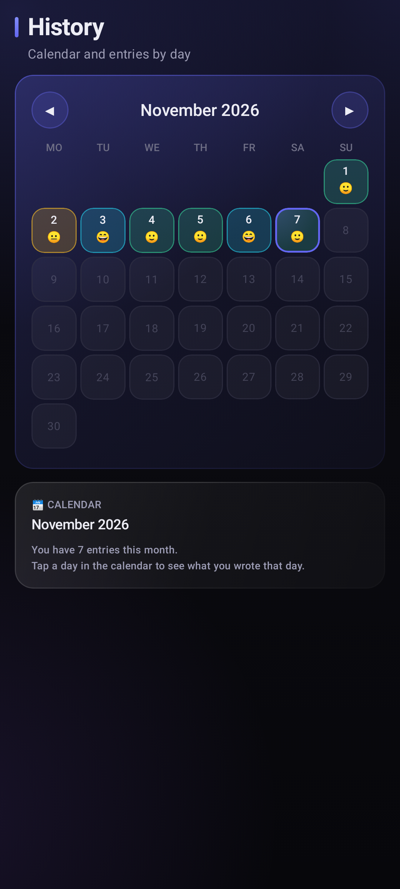
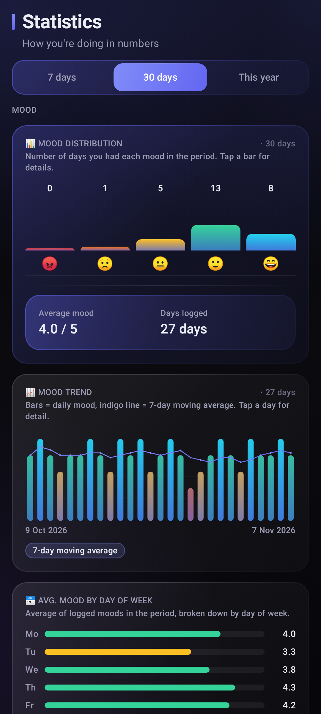
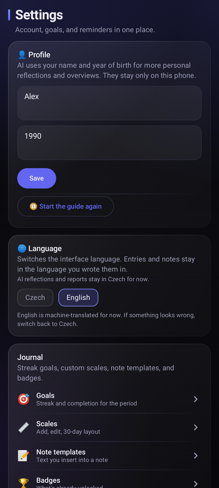
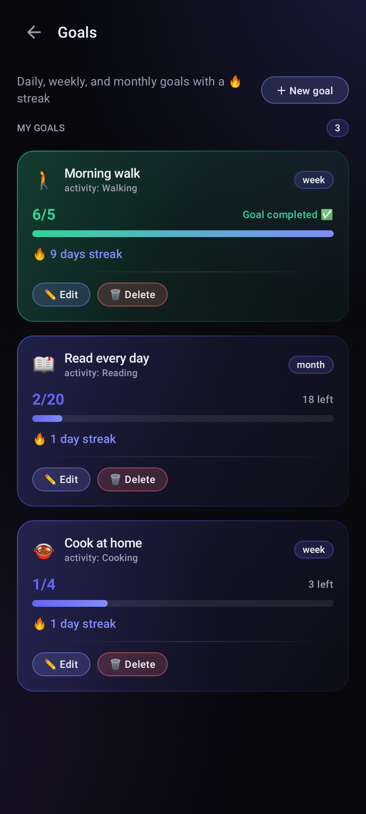
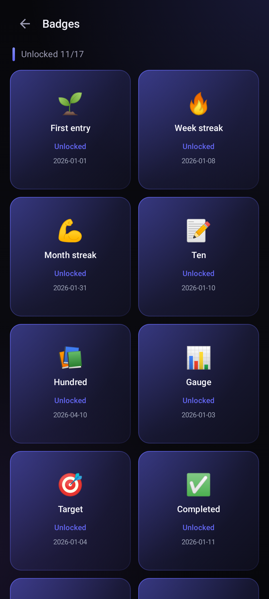
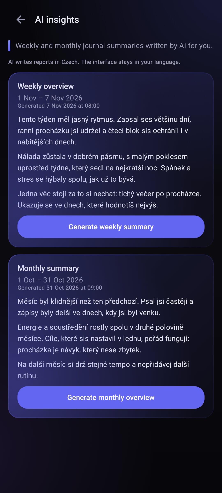

# Diarium for Android

A native Android diary for daily mood check-ins, habits, screen time, and reflections.

## Install beta 5

**[Download the beta 5 APK (2.0.0-beta5)](https://raw.githubusercontent.com/Vojta01/diarium-android/apk/diarium.apk)** (`diarium.apk`, from the `apk` branch). The direct APK identifies itself as `cz.digitalnivedomi.diarium`, version `2.0.0-beta5`.

The [GitHub Releases → Latest](https://github.com/Vojta01/diarium-android/releases/latest) page is a separate tagged build: its latest tag was `v2.0.0-alpha10` when checked on 2026-11-08. It is not this beta 5 APK. Use the direct link above when you specifically want beta 5; choose Latest only when you want the newest tagged release instead.

1. Download and open the APK on your Android device. If prompted, allow your browser or file manager to install apps from this source.
2. Sign in with Google.
3. Grant **Usage access** if you want screen-time statistics. It is optional for the diary and other features.
4. Allow notifications if you want reminders and report alerts.

**Requirements:** Android 8.0 (API 26) or later. Screen-time collection requires the Android Usage access permission; notifications require the relevant system permission.

## Screenshots

These are real app screens rendered with deterministic synthetic fixtures—not captures of a personal account. The interface is in English; generated AI report text is still in Czech. See [how screenshots are produced](docs/screenshots/README.md).

| | |
| --- | --- |
| [](docs/screenshots/en/01-dashboard.png) | [](docs/screenshots/en/02-check-in.png) |
| **Dashboard** | **Check-in** |
| [](docs/screenshots/en/03-history.png) | [](docs/screenshots/en/04-statistics.png) |
| **History** | **Statistics** |
| [](docs/screenshots/en/05-settings.png) | [](docs/screenshots/en/06-goals.png) |
| **Settings** | **Goals** |
| [](docs/screenshots/en/07-achievements.png) | [](docs/screenshots/en/08-ai-report.png) |
| **Badges** | **AI reports — the report body is Czech** |

## Features

- **Daily check-ins:** mood, sleep quality, stress, gratitude, notes and photos, activities, habits, and custom scales.
- **Dashboard and history:** daily summaries, streaks, a calendar, mood trends, and statistics.
- **Goals and achievements:** daily, weekly, or monthly activity goals, streaks, and unlockable badges. Note templates support quick entries.
- **Screen-time statistics:** device screen-on time, per-app foreground time, and unlock counts from Android's `UsageStatsManager`. Review and schedule sync in Settings; Usage access is required.
- **Reminders and reports:** configurable check-in reminders, a morning check for an incomplete previous day, and weekly/monthly report notifications. The app schedules these jobs on-device; Android may ask for notification and exact-alarm access.
- **AI reflections and reports:** daily reflections plus weekly/monthly summaries. The English interface does not translate generated prose: AI output currently remains in Czech.
- **CSV export:** save diary entries through Android's system document picker.
- **Czech and English interface:** English is currently machine-translated. Changing the interface language does not translate existing entries or AI output.

## Data and AI behavior

The app signs in with Google through Supabase Auth in a browser Custom Tab; its screens are native and do not run in a WebView. Account-backed diary data uses the configured Diarium/Supabase services. Screen-time information is read on-device and can be synced to the signed-in account when screen-time sync is enabled.

AI features process diary information to produce reflections or reports. When set, the locally stored profile name and birth year may be included with journal data in the prompt sent to DeepSeek. Daily reflections go through the configured Diarium endpoint. Weekly/monthly reports may be generated on-device and sent directly to DeepSeek with your own key, or requested from the Diarium server. The API key is encrypted in Android app storage. Review the applicable service terms before enabling AI features.

Account-scoped drafts, pending saves, and cached entries are kept separate; ownerless legacy records are quarantined rather than assigned to an account. See [local-data recovery](docs/account-local-data-recovery.md) before clearing app storage or reinstalling.

## Architecture

This is a **native Kotlin application with Jetpack Compose UI**; no WebView hosts the app. OAuth opens a Chrome Custom Tab and returns to the app through its `diarium://auth-callback` deep link.

- `app/src/main/java/cz/digitalnivedomi/diarium/ui/` — Compose screens, navigation, theme, and language handling.
- `app/src/main/java/cz/digitalnivedomi/diarium/core/data/` — repositories, session-aware network access, local stores, and domain data.
- `app/src/main/java/cz/digitalnivedomi/diarium/core/stats/` — screen-time aggregation and statistics logic; `app/src/main/java/cz/digitalnivedomi/diarium/stats/` adapts Android `UsageStatsManager` events.
- `app/src/main/java/cz/digitalnivedomi/diarium/auth/` — session and OAuth callback handling.
- `app/src/main/java/cz/digitalnivedomi/diarium/notifications/` and `app/src/main/java/cz/digitalnivedomi/diarium/sync/` — app-managed AlarmManager/WorkManager jobs, reminders, and background synchronization.

Journal and account APIs use the signed-in session. A few transitional Diarium endpoints remain for AI workflows. See the source packages and `app/build.gradle.kts` for the current wiring.

## Build from source

**Requirements:** JDK 17+ and Android SDK Platform 34. Set `ANDROID_HOME` or create a local, ignored `local.properties` containing `sdk.dir=/path/to/android-sdk`.

```bash
export ANDROID_HOME=/path/to/android-sdk
./gradlew assembleDebug
```

The debug APK is written to `app/build/outputs/apk/debug/app-debug.apk`. Optional `APP_VERSION_NAME` and `APP_VERSION_CODE` environment variables set its version; defaults are `1.0.0` and `1` (the debug variant adds `-debug` to the name).

### Local configuration and credentials

- Non-secret build constants and service endpoints are defined in `app/build.gradle.kts`. Do not put private service credentials or personal data in source or documentation.
- `app/google-services.json` is ignored by Git. Supply your own file locally only when building with Firebase configuration; do not commit it.
- Release signing can use a local, ignored root `keystore.properties` or `ANDROID_KEYSTORE_FILE`, `ANDROID_KEYSTORE_PASSWORD`, `ANDROID_KEY_ALIAS`, and `ANDROID_KEY_PASSWORD` environment variables. Without a stable release key, the release build falls back to the debug key and must not be distributed.
- The GitHub Actions APK workflow is manually dispatched. A tagged release is published only when the workflow has stable release signing configured; pushes to `main` do not automatically publish an APK.

Run unit tests with `./gradlew testDebugUnitTest`. To reproduce the documentation screenshots, follow [docs/screenshots/README.md](docs/screenshots/README.md).
