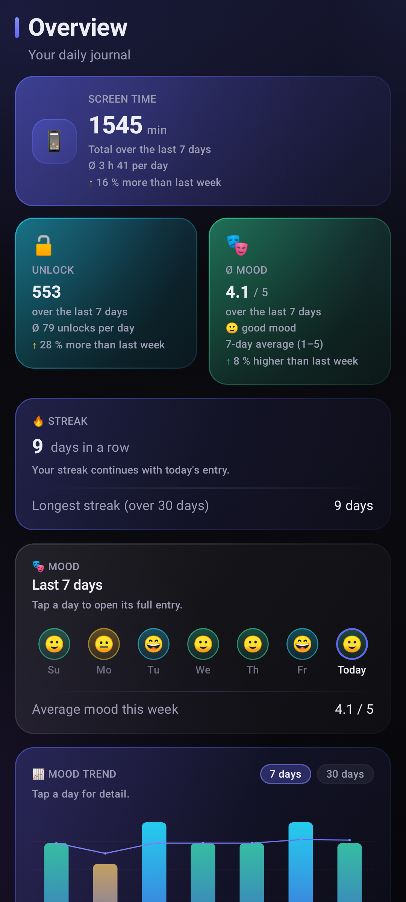
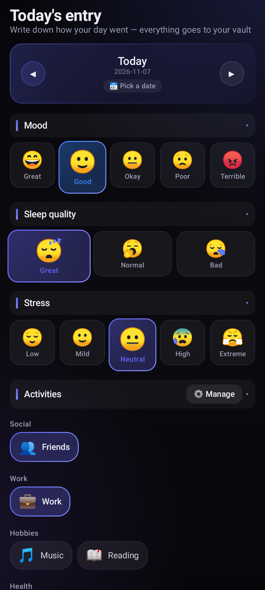
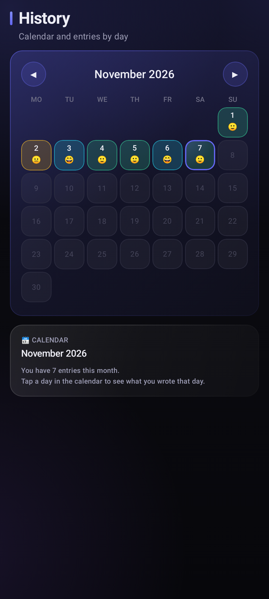
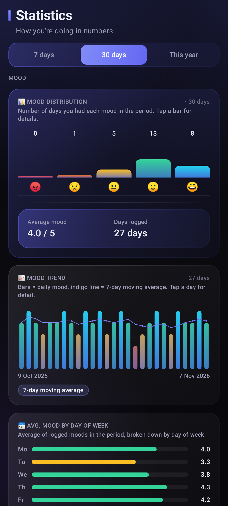
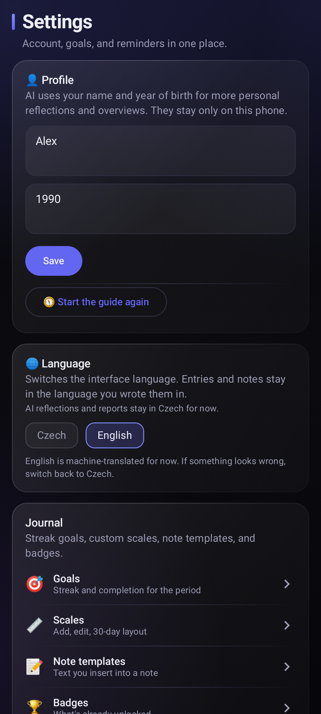
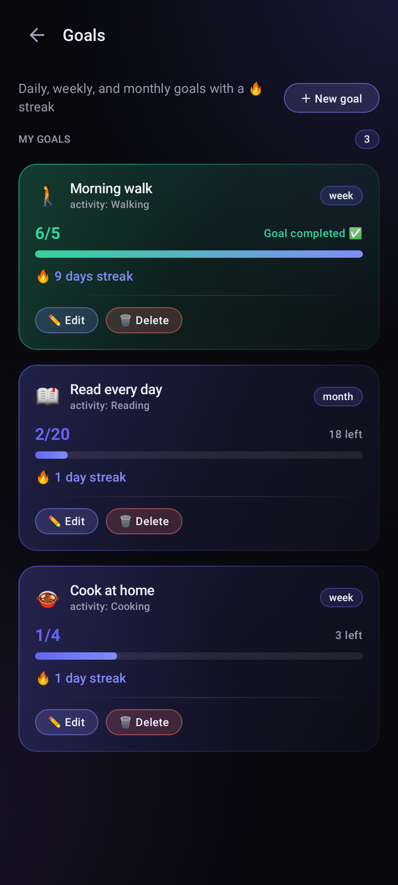
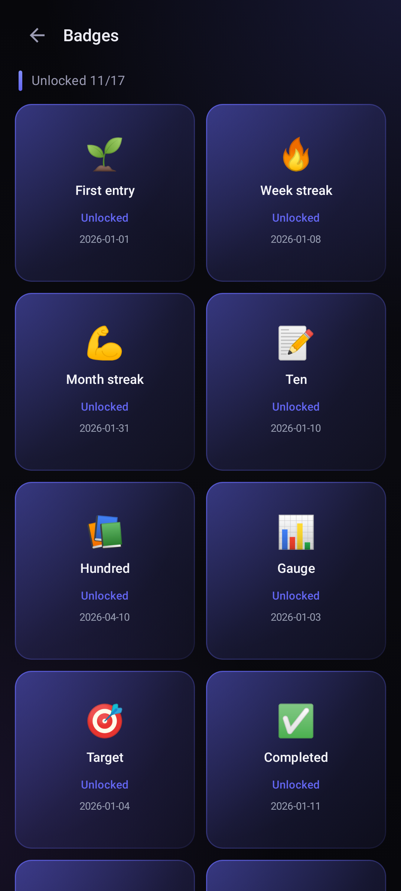
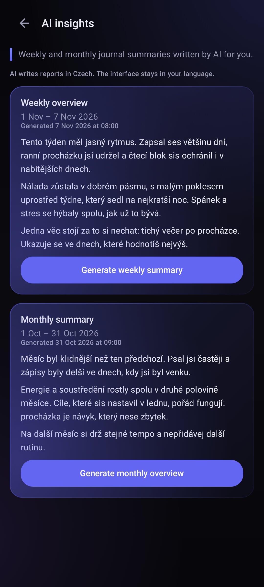

# English screenshot set

These eight PNGs are viewport captures of the app's real Jetpack Compose screens. The screenshot test mounts production screens, repositories, and state holders; only the HTTP transport is replaced with an in-process fake. The fixture and session are synthetic, the test makes no real network or OAuth requests, and it does not read anyone's account data.

The app interface is rendered in English through the normal localization layer. **AI report bodies intentionally remain in Czech**: the production report prompt asks for Czech prose, and Settings states that AI reflections and reports are not translated with the interface. The report screenshot shows that limitation rather than invented English report text.

## Gallery

| | |
| --- | --- |
| [](en/01-dashboard.png) | [](en/02-check-in.png) |
| **01 — Dashboard** | **02 — Check-in** |
| [](en/03-history.png) | [](en/04-statistics.png) |
| **03 — History** | **04 — Statistics** |
| [](en/05-settings.png) | [](en/06-goals.png) |
| **05 — Settings** | **06 — Goals** |
| [](en/07-achievements.png) | [](en/08-ai-report.png) |
| **07 — Badges** | **08 — AI reports (Czech generated text)** |

All eight files are 1080 × 2400 pixels (a 432 × 960 dp viewport at 400 dpi). These are single-screen captures, not full-page composites; content on scrollable screens can continue beyond the viewport.

## Reproduce

Requirements: JDK 17+ and Android SDK Platform 34. From the repository root:

```bash
export ANDROID_HOME=/path/to/android-sdk
./gradlew :app:screenshotEn
```

The task runs `EnglishScreenshotTest` with Robolectric `GraphicsMode.NATIVE` at SDK 34 and the pinned 432 × 960 dp, 400 dpi viewport. It sets the screenshot date to **2026-11-07**, fixes the locale to English, and writes the eight PNGs into `docs/screenshots/en/`. The fixture contains deterministic synthetic entries beginning on 2026-01-01. The date, locale, fixture, and viewport are fixed; two consecutive runs with this toolchain produced byte-identical PNGs. The checked-in images are losslessly re-encoded to reduce their size, so their PNG file hashes differ from the Gradle renderer output even though every decoded pixel is identical.

`EnglishScreenshotTest` is excluded from normal unit-test runs and checks the `diarium.screenshots` system property before writing files. `./gradlew testDebugUnitTest` therefore does not regenerate or overwrite the tracked screenshots; use the explicit `:app:screenshotEn` task to capture them.

The screenshot harness and deterministic fake backend live at:

- `app/src/test/java/cz/digitalnivedomi/diarium/ui/screenshots/EnglishScreenshotTest.kt`
- `app/src/test/java/cz/digitalnivedomi/diarium/ui/screenshots/FakeDiariumBackend.kt`

## Screenshot inventory

| Image | Screen |
| --- | --- |
| [01-dashboard.png](en/01-dashboard.png) | Dashboard / Overview |
| [02-check-in.png](en/02-check-in.png) | Daily check-in |
| [03-history.png](en/03-history.png) | History calendar for November 2026 |
| [04-statistics.png](en/04-statistics.png) | Statistics |
| [05-settings.png](en/05-settings.png) | Settings and language options |
| [06-goals.png](en/06-goals.png) | Goals and streaks |
| [07-achievements.png](en/07-achievements.png) | Badges / achievements |
| [08-ai-report.png](en/08-ai-report.png) | Weekly and monthly reports; generated report bodies are Czech |
